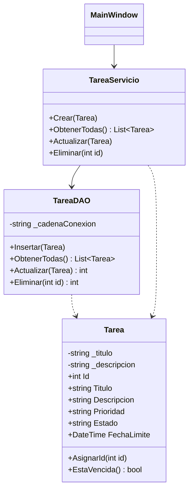
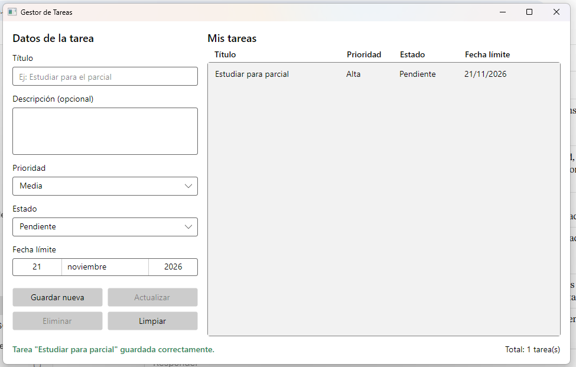
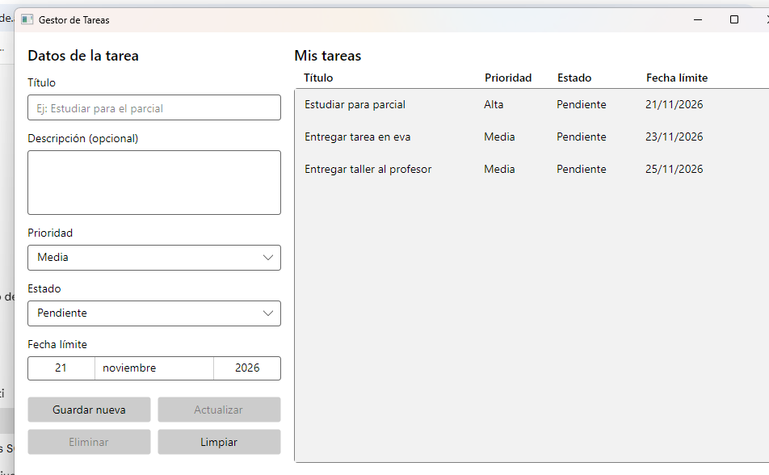
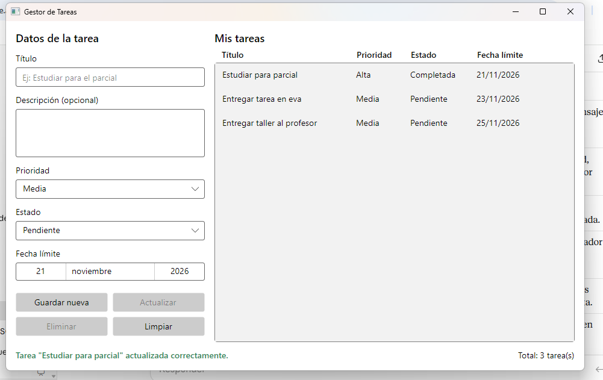
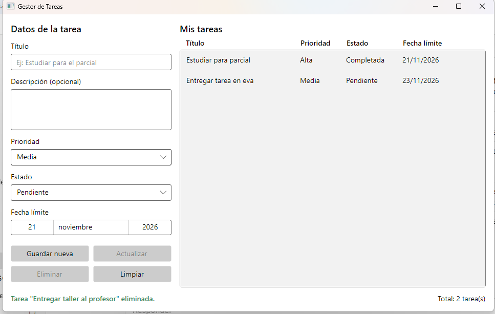
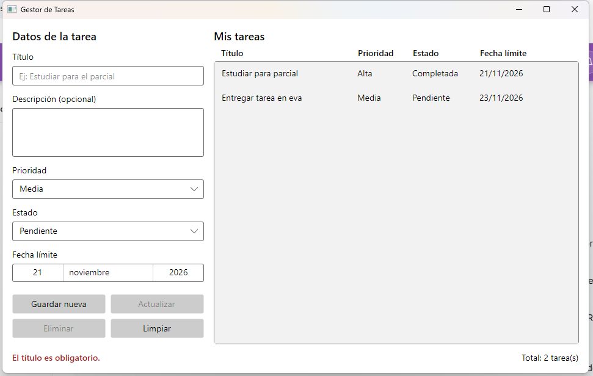

# Gestor de Tareas

Parcial final — Programación con C# y .NET
Americana Corporación Universitaria

## 1. Información general

- **Nombre del proyecto:** Gestor de Tareas
- **Estudiante:** Rafael Jose Saltarin Escobar
- **Descripción:** aplicación de escritorio que permite registrar, consultar, modificar y eliminar tareas personales, con prioridad, estado y fecha límite. Los datos se guardan en una base de datos SQLite.
- **Problema que resuelve:** llevar el control de las actividades pendientes en un solo lugar, sin depender de notas sueltas, y saber cuáles ya están vencidas.
- **Objetivo principal:** demostrar el uso conjunto de Programación Orientada a Objetos, Avalonia UI y ADO.NET para construir una aplicación completa con persistencia de datos.

## 2. Funcionalidades

- **Registrar** una tarea nueva (título, descripción, prioridad, estado y fecha límite).
- **Consultar** todas las tareas en una lista, ordenadas por fecha límite. Las tareas no completadas cuya fecha ya pasó se marcan como "(vencida)".
- **Modificar** una tarea: se selecciona en la lista, se editan los datos en el formulario y se pulsa *Actualizar*.
- **Eliminar** la tarea seleccionada.
- **Limpiar** el formulario para empezar de nuevo.
- **Validaciones** con mensajes claros: título obligatorio (máx. 80 caracteres), descripción de máx. 300 caracteres, prioridad y estado válidos, fecha obligatoria y no anterior a hoy en tareas nuevas.
- **Mensajes de resultado** en la parte inferior (verde si todo salió bien, rojo si hay error) y contador de tareas.
- Los datos **se conservan** al cerrar y volver a abrir la aplicación.

## 3. Tecnologías utilizadas

| Tecnología | Detalle |
|---|---|
| .NET | .NET 8 (`net8.0`) |
| Lenguaje | C# 12 |
| Interfaz gráfica | Avalonia UI 11.2.3 (XAML en archivos `.axaml`) |
| Acceso a datos | ADO.NET con `Microsoft.Data.Sqlite` 8.0.11 |
| Base de datos | SQLite |
| Paquetes | `Avalonia`, `Avalonia.Desktop`, `Avalonia.Themes.Fluent`, `Microsoft.Data.Sqlite` |

No se usa Entity Framework Core ni ningún otro ORM.

## 4. Estructura del proyecto

```
GestorTareas/
├── GestorTareas.csproj        Proyecto .NET y paquetes NuGet
├── Program.cs                 Punto de entrada
├── App.axaml / App.axaml.cs   Configuración de Avalonia y apertura de la ventana
├── Models/
│   └── Tarea.cs               Entidad Tarea
├── Data/
│   └── TareaDAO.cs            Acceso a SQLite con ADO.NET (CRUD)
├── Services/
│   └── TareaServicio.cs       Validaciones y reglas del programa
├── Views/
│   ├── MainWindow.axaml       Interfaz gráfica (XAML)
│   └── MainWindow.axaml.cs    Eventos de la interfaz
├── Database/
│   └── schema.sql             Esquema de referencia de la base de datos
├── evidencias/                Capturas de las pruebas
├── .gitignore                 Excluye bin/, obj/ y archivos .db
└── README.md
```

### Clases principales y responsabilidades

| Clase | Responsabilidad |
|---|---|
| `Tarea` | Representa los datos de una tarea. Tiene dos constructores (tarea nueva y tarea ya guardada) y el método `EstaVencida()`. |
| `TareaDAO` | Es la única clase que ejecuta SQL. Implementa Create, Read, Update y Delete con comandos parametrizados. |
| `TareaServicio` | Valida los datos y aplica las reglas antes de llamar al DAO. Es el intermediario entre la ventana y la base de datos. |
| `MainWindow` | Lee los controles, llama al servicio y muestra los resultados. No contiene SQL ni reglas de negocio. |

Flujo: `MainWindow` → `TareaServicio` → `TareaDAO` → SQLite.



### Dónde se aplica POO

- **Clases y objetos:** `Tarea` modela la entidad; cada fila de la base de datos se convierte en un objeto `Tarea`.
- **Propiedades y constructores:** `Tarea` usa propiedades y dos constructores sobrecargados.
- **Encapsulamiento:** el `Id` solo puede asignarse desde dentro de la clase (`private set` y `AsignarId`); `Titulo` y `Descripcion` usan campos privados y eliminan espacios sobrantes al asignarse.
- **Métodos:** `EstaVencida()` en `Tarea`; `Crear`, `Actualizar` y `Eliminar` en el servicio.
- **Separación de responsabilidades:** interfaz (`MainWindow`), lógica (`TareaServicio`) y datos (`TareaDAO`) están en clases y carpetas distintas.

No se usaron herencia ni polimorfismo, porque con una sola entidad no tenían una justificación funcional.

## 5. Instalación de dependencias

1. **Instalar el SDK de .NET 8** desde <https://dotnet.microsoft.com/download/dotnet/8.0>. Para comprobarlo:
   ```bash
   dotnet --version
   ```
   Debe mostrar una versión `8.x`.
2. **Obtener el código desde GitHub:**
   ```bash
   git clone <https://github.com/rafaelsaltarin01-lang/PARCIAL-FINAL-DESARROLLO-DE-SOFTWARE-CON-.NET.git>
   cd <PARCIAL-FINAL-DESARROLLO-DE-SOFTWARE-CON-.NET>
   ```
   (Si el repositorio tiene el proyecto dentro de una carpeta `GestorTareas/`, entrar también a ella con `cd GestorTareas`. El comando siguiente debe ejecutarse en la carpeta donde está `GestorTareas.csproj`.)
3. **Restaurar las dependencias:**
   ```bash
   dotnet restore
   ```
   Esto descarga Avalonia, Avalonia.Desktop, Avalonia.Themes.Fluent y Microsoft.Data.Sqlite. Se necesita conexión a internet la primera vez.
4. No se requiere ninguna configuración adicional.

## 6. Ejecución del programa

En la carpeta donde está `GestorTareas.csproj`:

```bash
dotnet restore
dotnet run
```

Se abre la ventana de la aplicación. No hace falta escribir comandos para usarla.

## 7. Base de datos

- **Información que almacena:** las tareas del usuario.
- **Tabla `Tareas`:**

| Campo | Tipo | Descripción |
|---|---|---|
| `Id` | INTEGER (clave primaria, autoincremental) | Identificador de la tarea |
| `Titulo` | TEXT | Título (obligatorio) |
| `Descripcion` | TEXT | Descripción (puede estar vacía) |
| `Prioridad` | TEXT | Alta, Media o Baja |
| `Estado` | TEXT | Pendiente, En progreso o Completada |
| `FechaLimite` | TEXT | Fecha en formato `yyyy-MM-dd` |

- **Conexión con SQLite:** `TareaDAO` construye la cadena de conexión con `SqliteConnectionStringBuilder` y abre una `SqliteConnection` de `Microsoft.Data.Sqlite` en cada operación, dentro de un bloque `using` para liberar los recursos.
- **Operaciones CRUD:** todas están en `Data/TareaDAO.cs`: `Insertar` (Create), `ObtenerTodas` (Read), `Actualizar` (Update) y `Eliminar` (Delete). Todas usan parámetros (`$titulo`, `$id`, etc.) y no concatenan texto del usuario en el SQL.
- **Creación e inicialización:** es **automática**. Al iniciar, el constructor de `TareaDAO` ejecuta `CREATE TABLE IF NOT EXISTS`, por lo que no hay que hacer ningún procedimiento previo. El archivo `Database/schema.sql` es solo una referencia del esquema.
- **Ubicación del archivo:** `tareas.db` se crea en la carpeta de datos del usuario (`LocalApplicationData/GestorTareas/`; en Windows, `C:\Users\<usuario>\AppData\Local\GestorTareas\tareas.db`). Para empezar con la base vacía basta con borrar ese archivo.

## 8. Evidencias de funcionamiento

### Prueba 1 — Registro
Se completa el formulario y se pulsa *Guardar nueva*. La tarea aparece en la lista y se muestra el mensaje verde de confirmación.



### Prueba 2 — Consulta
Al abrir la aplicación, la lista muestra las tareas almacenadas en la base de datos, con su prioridad, estado y fecha límite.



### Prueba 3 — Actualización
Se selecciona una tarea, se cambia un dato (por ejemplo, el estado a "Completada") y se pulsa *Actualizar*. La lista refleja el cambio.



### Prueba 4 — Eliminación
Se selecciona una tarea y se pulsa *Eliminar*. La tarea desaparece de la lista y el contador disminuye.



### Prueba 5 — Validación
Se intenta guardar con el título vacío. El programa muestra un mensaje de error en rojo y no se cierra ni guarda nada.



### Prueba 6 — Persistencia
Se cierra la aplicación y se vuelve a abrir con `dotnet run`. Las tareas guardadas siguen disponibles.


## 9. Problemas encontrados y soluciones

**Problema 1: dónde guardar el archivo de la base de datos.**
Al principio el archivo `.db` se creaba junto al ejecutable, dentro de `bin/`. Esa carpeta se borra al limpiar o recompilar el proyecto, y además no debe subirse a GitHub, por lo que los datos podían perderse.
**Solución:** guardar `tareas.db` en la carpeta de datos del usuario (`Environment.SpecialFolder.LocalApplicationData`), creando la carpeta si no existe. Así los datos persisten aunque se recompile el proyecto.

**Problema 2: la fecha del `DatePicker`.**
El control de Avalonia devuelve la fecha como `DateTimeOffset?` (puede ser nula), mientras que el modelo usa `DateTime`.
**Solución:** comprobar que haya una fecha seleccionada antes de crear la tarea y convertirla con `.DateTime`. En la base de datos se guarda como texto `yyyy-MM-dd` con `CultureInfo.InvariantCulture` para evitar errores por la configuración regional del computador.

**Problema 3: la selección de la lista se borraba al recargar.**
Al volver a cargar la lista tras guardar, la selección se perdía y el evento `SelectionChanged` se disparaba con valor nulo.
**Solución:** leer los datos necesarios (Id y título) antes de recargar la lista y, en el evento, desactivar los botones *Actualizar* y *Eliminar* cuando no hay selección.
